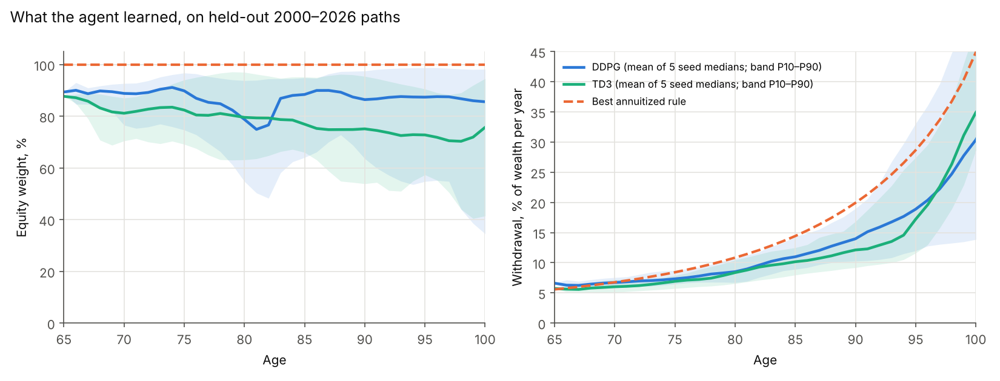

# Deep-RL retirement decumulation

**The idea in three sentences.** A retiree at 65 with $1M and $2,000 a month of guaranteed income has to decide, every year until death, how much to spend and how much to hold in equities, facing sequence-of-returns risk and an unknown lifespan. Classical theory (Merton, Yaari) solves a stylised version in closed form; this project asks whether a model-free deep-RL agent, given only the reward and a simulator built on 70 years of real US market history, finds that solution on its own and holds up on data it never saw. The agent maximises expected CRRA utility of real consumption, weighted by survival, and is scored against benchmark rules tuned on the same training data.

**Headline result.** Never shown the theory, the agent finds the closed-form policy's shape at a more conservative level: its spending as a share of wealth rises with age, as the annuity rule's does, but at 90 it withdraws 12–14% of wealth a year against the rule's 20% (30–35% against 45% at 100), and from 65 to 90 it holds 75–91% in equities against the rule's 100%. On 2000–2026 data held out from training it scores **$6,129/month** certainty-equivalent (DDPG, five seeds) against **$6,080** for the tuned annuitized rule, **$5,810** for the best constant-percentage rule and **$5,077** for the 4% rule. Its score is about the same as the closed form's and does not robustly beat it: the +$49 held-out edge becomes −$70 when multi-year regimes are kept intact. The most useful result is a failure caught on the way: an earlier version that could see macro state memorised which block of history came next, scoring +$969/month in-sample and −$227 held out (`RESULTS.md`, §2).



## What is here

| Path | Contents |
|---|---|
| `demo.py` | Two-minute demo on the shipped checkpoints: held-out comparison table, then a month-by-month replay of a real retirement (default: retiring into January 2000). No training, no network |
| `app.py` | The same, interactive: `streamlit run app.py` |
| `RESULTS.md` | Every number, how it was produced, and how far to trust it |
| `PROTOTYPE_AUDIT.md` | What the April 2026 prototype claimed, what its code actually did, and what replaced it |
| `decumulation/` | Simulator (`sim.py`), gym environment (`env.py`), benchmark rules (`policies.py`), Gompertz mortality, CRRA utility, block bootstrap |
| `train.py`, `run_all.sh` | Train one agent / reproduce every shipped checkpoint (≈75 min on a 2-core CPU) |
| `evaluate.py` | Tune the rules, evaluate every checkpoint, write `results/results.json` and the figures |
| `data/` | Frozen inputs (Ken French library, FRED), `build_dataset.py`, `SOURCES.md` |
| `checkpoints/` | Five DDPG and five TD3 agents (seeds 0–4); ablations: two seeds each with macro features, and two DDPG seeds that reproduce the leak (`_leaky`) |
| `tests/` | 15 tests, including path-lagged (non-memorisable) macro state, seeded reproducibility, and exact agreement between the training reward and the evaluation objective |
| `make_page.py` | Builds the site's decumulation tab (`docs/decumulation.html`) from `results/results.json` |

## The model

- **Markets.** Monthly real returns, 1955–2026: US total market (Mkt-RF + RF, CRSP via the French library) and a 10-year Treasury built from FRED yields. Lifetimes are 12-month block bootstraps of that history. **Training draws only from 1955–1999; evaluation reports 2000–2026 separately**, which contains the dot-com crash, 2008, 2020 and the 2022 bond crash.
- **Decisions.** Once a year: an equity weight in [0, 1] and a withdrawal rate of 1–60% of wealth per year. Inside the year, returns, rebalancing and withdrawals are monthly.
- **Observation.** Wealth and age. (Ablation: plus Fed funds, term spread and trailing inflation, lagged one month along the simulated path, and last month's return.)
- **Objective.** E[Σ βᵗ S(t) u(cₜ)]: CRRA utility (γ = 4) of real consumption, guaranteed income plus withdrawals, weighted by Gompertz survival S(t) (m = 88, b = 10; median death age 85.7) and β = 0.999/month. Running out of money is not a separate penalty: the retiree lives on the $2,000 floor, and the utility function prices that.
- **Agents.** DDPG and TD3 (Stable-Baselines3), 64×64 MLPs, 150,000 annual decisions (3,750 simulated lifetimes) each, five seeds per algorithm.
- **Score.** Certainty-equivalent consumption (CEC): the constant real monthly spending worth the same expected utility as the policy's uncertain stream.

## Benchmarks

| Rule | What it does |
|---|---|
| 4% rule, 60/40 | Bengen (1994): fixed real withdrawal of 4% of starting wealth; the only fixed-dollar rule, and the one that runs out most often |
| Best constant mix | Fixed equity weight and fixed spending rate, both grid-searched on training data |
| Best annuitized | Fixed equity weight; spend wealth divided by the survival-weighted annuity factor at a real rate r (the Merton/Yaari closed-form structure); equity and r grid-searched on training data |
| 110-minus-age | Rule-of-thumb glide path with annuitized spending |

## Honest limits

- **In this setting the closed-form rule is close to optimal, so the best an agent can do is match it.** That is the result: evidence that the RL machinery works, not that RL beats theory. An edge would need genuine state dependence the closed form can't absorb — a fitted regime or VAR return model, fat-tailed shocks, taxes, annuity purchases — none of which is in this simulator.
- **Historical bootstrapping invites memorisation.** Any observation that identifies the calendar month lets a network learn what the next block of history holds. The first rebuild did exactly that (see `RESULTS.md`, §2). The default agent therefore observes only wealth and age; macro features are an ablation, lagged along the simulated path.
- Returns are index returns: CRSP total market and a 10-year Treasury built from monthly-average yields. No fees, taxes, credit or TIPS.
- Mortality is a two-parameter Gompertz law (Milevsky's m = 88, b = 10), not a life table; no couples, health or long-term-care shocks.
- 2000–2026 is one realisation of history. Bootstrapping it gives many lifetimes, but they share its regimes. The rules tuned in-sample choose 100% equity, which that window punished relative to 1955–1999.
- Agents decide once a year; the rules they are compared against adjust every month, which if anything favours the rules.
- Nothing here is peer-reviewed.

## Running it

```
pip install -r requirements.txt
python3 demo.py                      # held-out table + 2000 retiree replay
python3 demo.py --cohort 2007-01     # retire into the financial crisis
streamlit run app.py                 # interactive version
python3 -m pytest -q tests           # 15 tests, < 1 s
python3 evaluate.py                  # full evaluation, ≈ 8–10 min
./run_all.sh                         # retrain every checkpoint, ≈ 75 min
```

## Prior art and sources

- R. C. Merton, "Lifetime portfolio selection under uncertainty," *Rev. Econ. Stat.* (1969), and "Optimum consumption and portfolio rules in a continuous-time model," *J. Econ. Theory* (1971).
- M. E. Yaari, "Uncertain lifetime, life insurance, and the theory of the consumer," *Rev. Econ. Stud.* (1965).
- W. P. Bengen, "Determining withdrawal rates using historical data," *J. Financial Planning* (1994).
- M. A. Milevsky, *The 7 Most Important Equations for Your Retirement* (2012), for the Gompertz parameterisation.
- T. P. Lillicrap et al., "Continuous control with deep reinforcement learning" (DDPG, 2016); S. Fujimoto et al., "Addressing function approximation error in actor-critic methods" (TD3, 2018).
- Data: Kenneth R. French Data Library; Federal Reserve Economic Data (FRED). See `data/SOURCES.md`.

Built on open literature and public data only. The 2026 rebuild was done with AI coding assistants under my direction; `PROTOTYPE_AUDIT.md` and `RESULTS.md` record what was checked and how.
